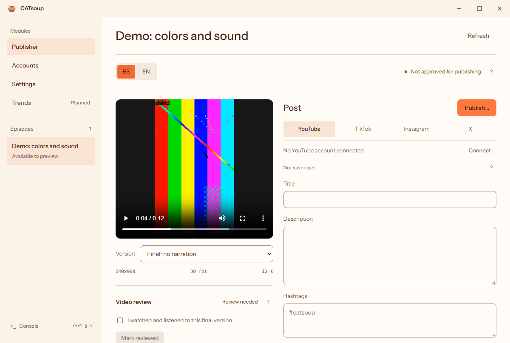

# CATsoup Publisher

A lightweight, local Windows desktop workspace for reviewing bilingual video
deliveries and preparing them for publication. Built with Go, Wails and Vue.

Publisher prepares bilingual drafts and sends approved videos to YouTube privately,
the TikTok inbox, or Instagram Reels. X uses the browser composer. Bring your own
authorized accounts and provider configuration. [Connection setup and upload guide](docs/publisher/UPLOADS.md)



Browser-rendered preview using the generated demo; no private episode assets.

## What works

- Read-only delivery catalog with file hashes and technical validation.
- Spanish/English previews with playback, audio, seeking and version selection.
- Clear separation between a valid delivery and permission to publish it.
- Custom desktop title bar, keyboard focus and reusable CATsoup design tokens.
- SQLite drafts per episode, language, platform and account label, with autosave,
  conflict detection, copyable metadata and access to the selected video's folder.

The Windows executable is about 16.9 MiB; it uses the installed WebView2 runtime.
That size excludes WebView2, Python, FFmpeg and development tools. RAM/CPU usage
has not yet been benchmarked. This is a source preview, not an installer release.

New installation? Follow the [first-run setup guide](https://publisher.meruw.dev/guides/setup/) for installation, developer credentials and ES/EN sign-in.

## Build and run (Windows x64)

Install Python 3.10 or newer, Git and Microsoft WebView2.
Run these commands in PowerShell from the repository root:

```powershell
python -m venv .venv
.venv/Scripts/python.exe -m pip install -r requirements.txt
powershell -ExecutionPolicy Bypass -File apps/publisher/setup.ps1
powershell -ExecutionPolicy Bypass -File apps/publisher/build.ps1
apps/publisher/bin/CATsoupPublisher.exe
```

Setup downloads pinned Node.js (with npm), Go and Wails build tools into `.tools/`; build installs locked npm
packages, generates native resources and bindings, type-checks and runs Go tests.
Initial setup requires internet. Review/import/playback run locally afterward.
The Python environment is used for the shared delivery validator, not a server.

Start with an empty library, or generate a synthetic sample (color bars and tones,
not a real episode; ignored by Git and explicitly not publishable):

```powershell
.venv/Scripts/python.exe apps/publisher/support/create_demo.py
apps/publisher/bin/CATsoupPublisher.exe --check
```

Place your own contract-v2 packages in `deliveries/<episode-id>/`. See
[the contract](contracts/delivery/CONTRACT.md). IDs currently use the `catsoup-`
prefix and supported languages are ES/EN. The contract's production provenance
fields describe the original producer; this application does not require that
producer or its source files. Keep all media inside its delivery folder.

The executable finds this workspace above its own directory. To review an
existing compatible workspace, use `--root C:\path\to\workspace`; that workspace
must have the validator and `.venv` layout too. Close the app before rebuilding.

## Connect accounts

Open **Accounts**, select **ES** and connect the channel for each platform you use. Repeat under **EN** for your English channels. Google, TikTok and Facebook sign-in start in Publisher and open the provider in your browser. First-time operators can import their own app credentials in **Settings → Developer credentials**. X stores a handle for manual posting. Each draft uses the assigned destination for its language. See [account setup](docs/publisher/UPLOADS.md).

## Prepare a publication draft

1. Select an episode, ES/EN and the video version to preview.
2. Click **Publication** beside Refresh, choose a platform, enter an account label and click
   **Open draft**. Labels identify destinations; they do not connect to accounts.
3. Edit the title, description and hashtags. Changes save after 600ms without
   typing, or with **Save draft**. Wait for **Saved locally** before force-quitting.
4. Use **Copy title**, **Copy caption** (description plus hashtags), or **Open video
   folder** to prepare a manual upload. These controls do not publish anything.
5. For an approved delivery, open the platform in your browser and check which
   account is active. Under **Manual upload**, confirm the account and click
   **Copy upload file path**. Paste it into the file picker to select the linked
   final MP4 for that language. Complete the upload on the platform.

Switching episode/language/destination or closing normally flushes pending edits.
A failed save blocks navigation/closing and keeps the text visible. Conflicts with
another instance require an explicit reload decision; they are not silently overwritten.
If the delivery changed, review the video and choose **Use selected video** to
update the draft's link. Ordinary text edits never update that link automatically.

Drafts live at `data/publisher/drafts.sqlite` in the selected workspace, outside
Git. They do not change manifests, reviews or approvals. See
[storage and recovery](docs/publisher/DRAFTS.md). Text limits are local storage
bounds, not guarantees about what each platform accepts.

## Development

- [Architecture](docs/publisher/ARCHITECTURE.md)
- [Design system](docs/publisher/DESIGN_SYSTEM.md)
- [Checks and contribution workflow](CONTRIBUTING.md)
- [Security boundaries](SECURITY.md)
- [Current status and next milestone](docs/publisher/STATUS.md)

This repository contains Publisher and the shared delivery contract only.
Production scripts, private episode data, videos, accounts and the original
workspace's Git history are not included. Trends remains a disabled planned item;
its implementation is a separate project.

## License and credits

Original project code is licensed under **GPL-3.0-only**. See [LICENSE](LICENSE).
Copyright (C) 2026 CATsoup Publisher contributors. Provided without warranty.
Third-party components keep their own licenses; see [NOTICES.md](NOTICES.md).
The license does not grant trademark rights or imply endorsement by CATsoup.
